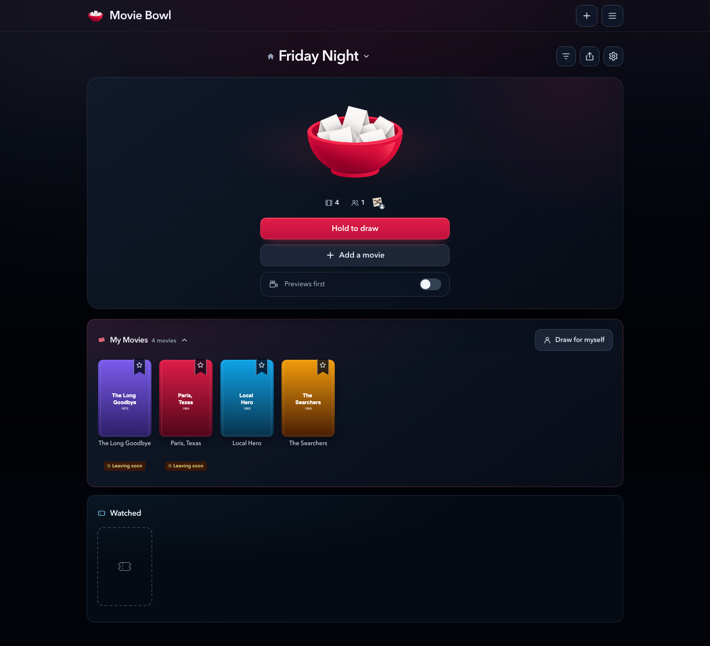
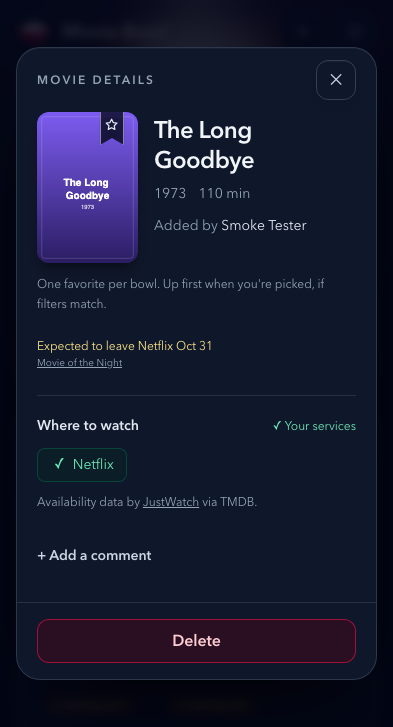

# Departure notices in the bowl

Captured from the actual app with the Playwright fixture backend on October 19,
2026. The bowl, account, poster artwork, availability, and departure dates are
fixtures. These images do not claim that the named movies are leaving Netflix.

My Movies uses a small amber clock and **Leaving soon** marker under the title.
The marker's accessible description and desktop hover text name the service and
date. Opening details shows **Expected to leave Netflix Oct 31**, or **Leaving
Netflix soon** when the provider has no date, with a Movie of the Night credit.
Titles with no current notice get no marker or extra blank row.

Search keeps the same service/date notice and credit when fresh shared data
already exists. Searching and opening an unsaved title cannot spend Movie of
the Night quota. A visible active bowl movie can refresh the shared entry only
if it matches one of the viewer's saved, supported US services; SQL verifies
bowl membership and the active title before reserving a request.

| Surface | Desktop | Mobile |
| --- | --- | --- |
| Populated bowl | [View](desktop-chromium-bowl.png) | [View](mobile-chromium-bowl.png) |
| Saved movie details | [View](desktop-chromium-saved-details.png) | [View](mobile-chromium-saved-details.png) |
| Cached search notices | [View](desktop-chromium-search.png) | [View](mobile-chromium-search.png) |
| Search movie details | [View](desktop-chromium-search-details.png) | [View](mobile-chromium-search-details.png) |





To refresh the captures with local fixtures:

```sh
CAPTURE_DEPARTURES=1 npm run test:e2e -- e2e/departureNotices.e2e.js --workers=2
```

The browser tests also cover a search cache miss followed by a successful saved
card lookup, a notice with no date, service mismatch, and no horizontal page
overflow on desktop or mobile. API and pgTAP tests exercise the actual server
policy separately; the browser fixture does not reproduce the database logic.
